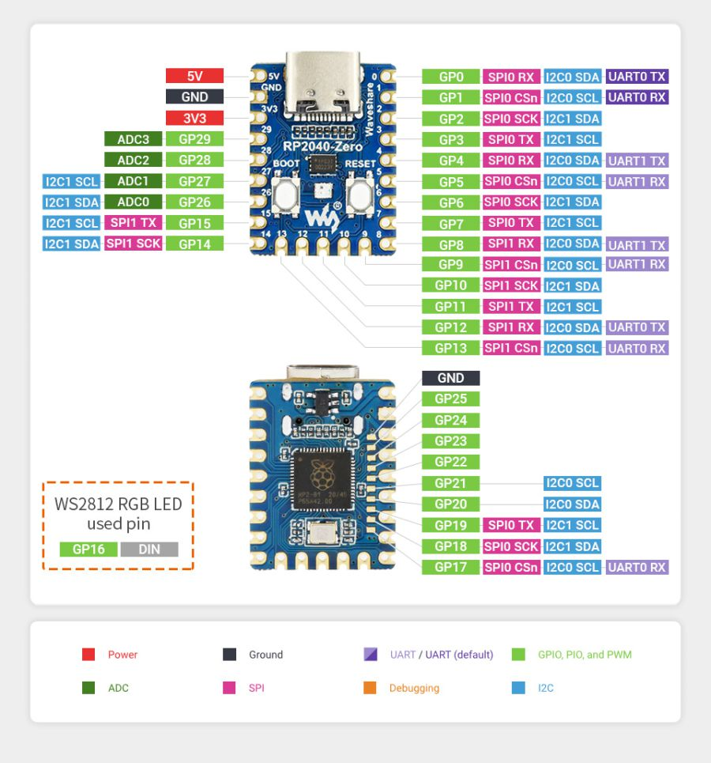
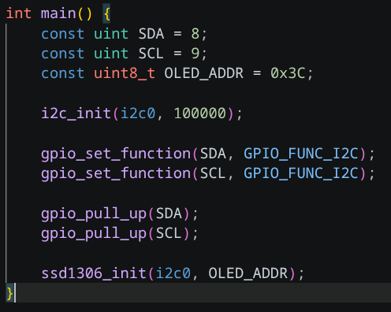
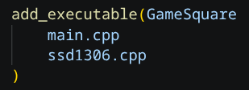
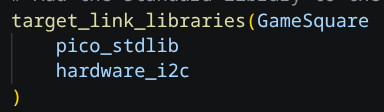

# Leroy-s_SSD1306_Library_for_Waveshare_RP2040_Devboard_Guide
This tutorial is for Waveshare RP2040 Zero's and their clones, but it should apply to more RP2040 Devboards (:

# DECIDING WHICH PINS TO USE

Pick an I2C pair from this diagram, both I2C1 and I2C0 are fine:

For this guide, I'm using GPIO 8 for SDA and GPIO 9 for SCL, making an I2C0 pair. 

# SETTING THINGS UP IN YOUR CODE

In your code, include:

and in your main:

In your CMakeLists.txt file, make sure that add_executable includes:

and that your target_link_libraries has:

Remember to put the two files from the Library folder in this repo into your project folder!

# USE

Start with: 

ssd1306_text works by (x, y, "text"). Remember, 0, 0 is the top-left of the screen. 

