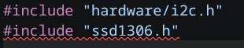

# Leroy-s_SSD1306_Library_for_Waveshare_RP2040_Devboard_Guide
This tutorial is for Waveshare RP2040 Zero's and their clones, but it should apply to more RP2040 Devboards (:

# DECIDING WHICH PINS TO USE

Pick an I2C pair from this diagram, both I2C1 and I2C0 are fine:

For this guide, I'm using GPIO 8 for SDA and GPIO 9 for SCL, making an I2C0 pair. 

# SETTING THINGS UP IN YOUR CODE

